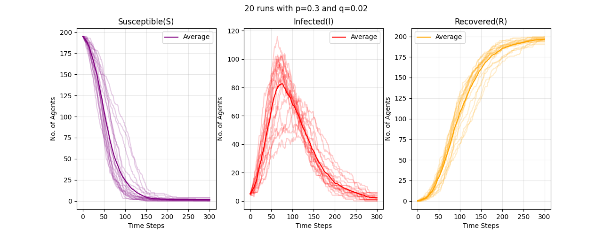
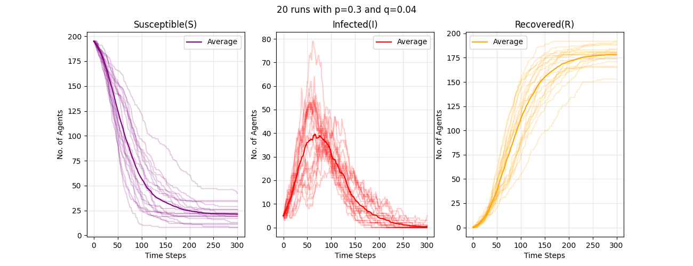
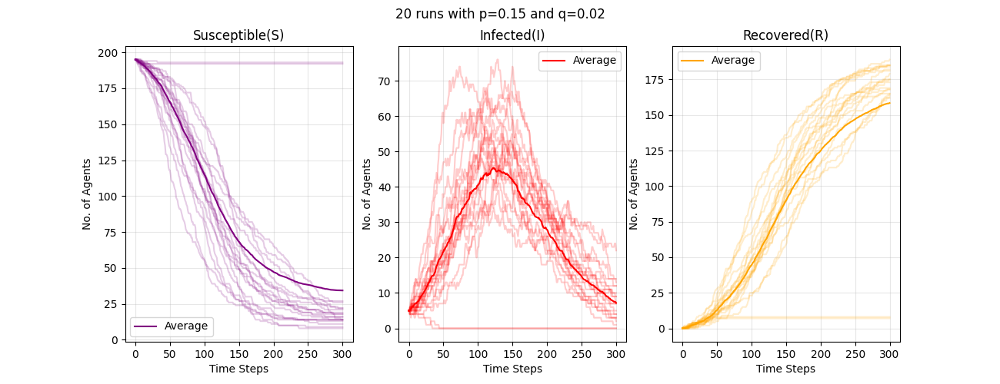
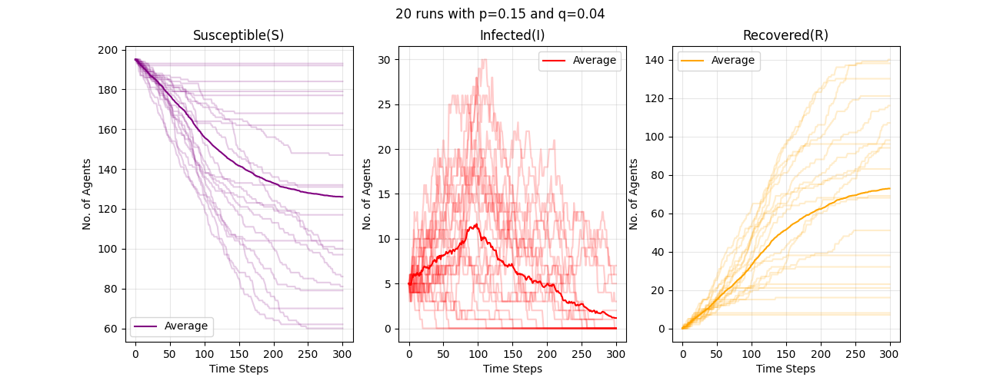
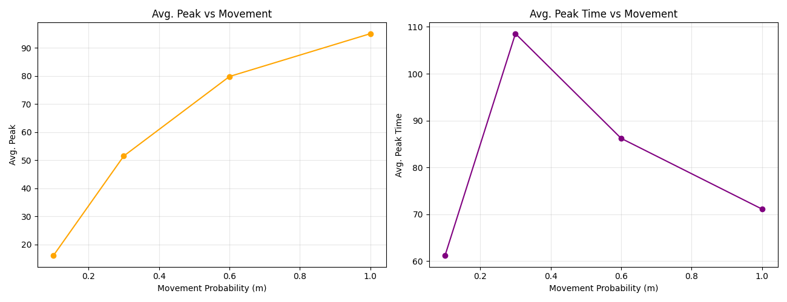
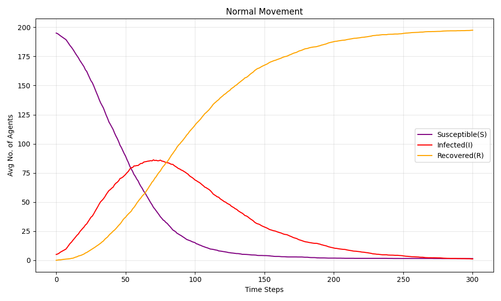
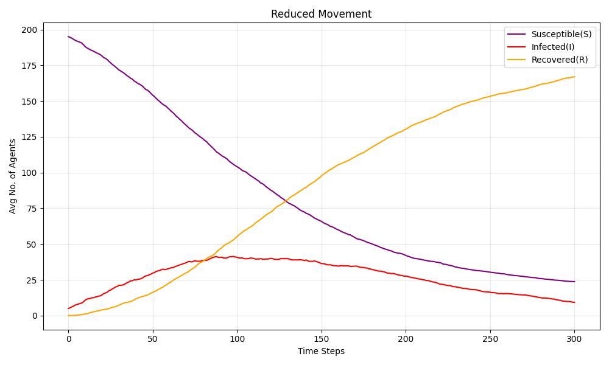
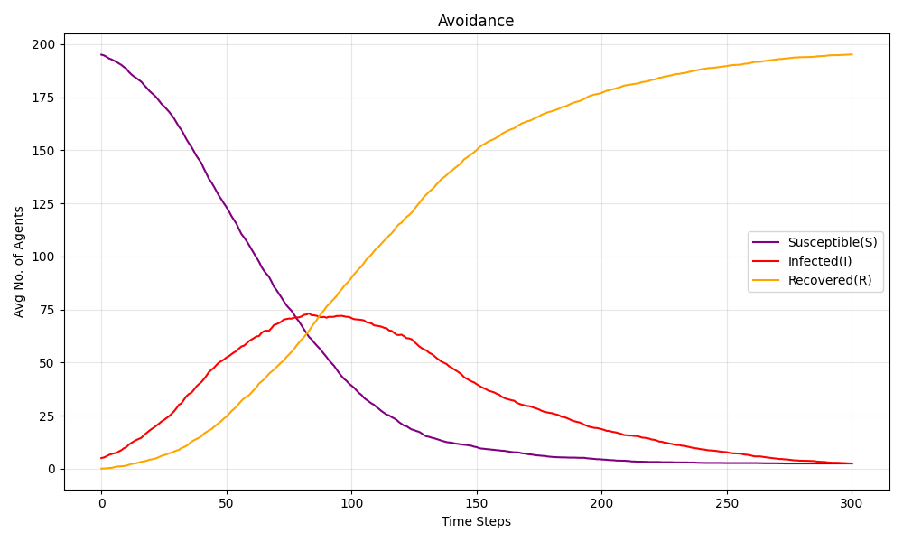

# BMI500 Week-7 Homework: Agent-Based Modeling of Pandemic Spread

**Name -** Shashank Chauhan  
**Email -** shashank.chauhan@emory.edu

## Overview
In this homework assignment I simulated the spread of infection for 200 agents with 300 time steps.

## Part A Base Model
I tested four combinations of infection probability p and recovery probability q with 20 runs in each. And here are my observations -
- if we set the p high, we get to see higher infection peak and higher total no. of infections as well. 
- If we set the q high, we get to see lower infection peak with lower total no. of infections.

## Part B Social Distancing
In this part, we kept the p and q constant and use 4 different values of m which is movement and ran simulation for 20 runs each. From the results I observe that if we lower the m, infection peak gets decreased which means social distancing reduced the infection peak but interestingly it did not delay it always.

We also compared normal movement, reduced movement and avoidance where the reduced movement out performed the other two in terms of lowering the peak.

 *(Detailed results are in notebook with my observations.)*

## Hypothesis
- Partial Supported - Reducing the movement helped in lowering the peak, but did not delay it in all cases.
- Supported - Individual runs differed due to randomness.
- Supported - Average curves look similar to the SIR model that we studied in the lecture.

## Limitations
- This is a very simple model where we used just 200 agents as compare to the real world setting. 
- We used very basics rules in agent movement and did not consider the edge cases.

## How to Run
- Install Python, NumPy, Matplotlib.
- Open `Chauhan_week7_hw.ipynb` in Google Colab.
- Run all cells one by one.

## AI Usage

Statement: I used Claude Code to visualize this simulation like a game. I got inspired by the given reference YouTube video of simuating the pendemic. I have atatched it - Please check it once (simulation.html)

The full chat with Claude is here - 
https://claude.ai/share/689908fb-ac49-421a-8fb6-5a4367a9595f